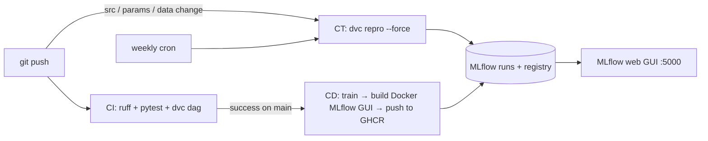

# MLOps Demo – ML + DL with CI / CD / CT

A small but complete MLOps project:

| Layer | Tool | What it does here |
|---|---|---|
| Source control | **Git + GitHub** | code, params, DVC metadata |
| Data & pipeline versioning | **DVC** | 4-stage reproducible pipeline (`dvc.yaml`), tracked data/models/metrics |
| Experiment tracking & registry | **MLflow** | params, metrics, plots, models, **web GUI**, model registry |
| Automation | **GitHub Actions** | CI (lint+test), CT (retrain), CD (publish MLflow GUI image) |

**Models**

* **ML** – `RandomForestClassifier` on the Wine dataset (scikit-learn)
* **DL** – 3-layer MLP on the Digits dataset (PyTorch), per-epoch loss/accuracy curves

Both datasets ship with scikit-learn, so nothing has to be downloaded.



## DVC pipeline

```
prepare ──► train_ml ──┐
        └─► train_dl ──┴─► evaluate (quality gate + "champion" alias)
```

`evaluate` fails the pipeline (red workflow) if accuracy falls below the thresholds in
`params.yaml`; if it passes, the new model version gets the **`champion`** alias in the MLflow
Model Registry.

## 1. Run it locally

```bash
python -m venv .venv && source .venv/bin/activate      # Windows: .venv\Scripts\activate
pip install -r requirements.txt

make test        # lint + unit tests:  ruff check src tests && pytest -q
make train       # = bash scripts/run_with_mlflow.sh dvc repro
make ui          # open  http://127.0.0.1:5000   ← the MLflow web GUI
```

No `make`? (Windows) run the commands inside the Makefile directly, or use Git-Bash/WSL for
`scripts/run_with_mlflow.sh`.

In the GUI look at:

* **Experiments → mlops-demo** – both runs, sortable table, *Chart view*, compare runs
* Run → **Model metrics** – `train_loss` / `test_accuracy` curves for the DL run
* Run → **Artifacts** – `confusion_matrix.png`, `params.yaml`, the logged model
* **Models** tab – `wine-rf-classifier`, `digits-mlp-classifier` with the `champion` alias

Change something (e.g. `ml.n_estimators` in `params.yaml`), `make train` again, and compare
the two runs in the GUI. DVC only re-runs the stages whose inputs changed
(`dvc repro --force` re-runs everything).

## 2. Put it on GitHub

```bash
git init -b main
git add .
git commit -m "Initial commit: ML + DL pipeline with MLflow, DVC, GitHub Actions"

# after creating an EMPTY repo on github.com:
git remote add origin https://github.com/<you>/<repo>.git
git push -u origin main
```

Then commit the DVC lock file produced by your first local run:

```bash
make train
git add dvc.lock data/.gitignore models/.gitignore metrics reports
git commit -m "Add dvc.lock and metrics" && git push
```

### Workflows (Actions tab)

| Workflow | Trigger | Result |
|---|---|---|
| **CI** `ci.yml` | every push / PR | ruff, pytest (ML+DL smoke tests), `dvc dag`, `dvc repro --dry` |
| **CT** `ct.yml` | push to `main` touching src/params/data, **weekly cron**, manual | `dvc repro --force`, job summary with metrics, uploads **`mlflow-results`** artifact, commits fresh `dvc.lock` |
| **CD** `cd.yml` | CI succeeded on `main`, manual | trains, builds `Dockerfile.ui`, smoke-tests the GUI, pushes `ghcr.io/<you>/<repo>/mlflow-ui` |

Repo settings needed: *Settings → Actions → General → Workflow permissions →
**Read and write permissions*** (CT commits `dvc.lock`; CD pushes to GHCR).

## 3. Getting the MLflow GUI from the pipeline

GitHub runners are temporary, so a "live" GUI needs one of these:

**A. Docker image built by CD (recommended for the demo)**

```bash
docker run --rm -p 5000:5000 ghcr.io/<you>/<repo>/mlflow-ui:latest
# → http://localhost:5000
```

(First time: make the package public under *Profile → Packages → Package settings*, or
`docker login ghcr.io` with a personal access token.)

**B. Artifact from CT**

Actions → CT run → *Artifacts* → download **mlflow-results**, unzip into the repo root:

```bash
make ui     # → http://127.0.0.1:5000
```

**C. Hosted MLflow (always-online GUI) – optional**

Create a free repo on [DagsHub](https://dagshub.com), connect it to your GitHub repo and add
these repository secrets:

```
MLFLOW_TRACKING_URI       https://dagshub.com/<user>/<repo>.mlflow
MLFLOW_TRACKING_USERNAME  <dagshub username>
MLFLOW_TRACKING_PASSWORD  <dagshub token>
```

CT then logs straight to the hosted MLflow UI. (CD keeps using its own local server so the
Docker image stays self-contained.)

## 4. DVC remote (optional)

Outputs are fully reproducible from code + `params.yaml`, so CI works without a remote. To also
push data/models to storage:

```bash
dvc remote add -d storage <s3://bucket/path | gdrive://<folder-id> | /some/local/dir>
dvc push
git add .dvc/config && git commit -m "Configure DVC remote"
```

## Project layout

```
.github/workflows/   ci.yml  ct.yml  cd.yml
src/                 prepare_data.py  train_ml.py  train_dl.py  evaluate.py  common.py
tests/               pytest suite
scripts/             run_with_mlflow.sh   (starts MLflow server → runs a command)
dvc.yaml params.yaml .dvc/               pipeline, hyper-parameters, DVC config
Dockerfile.ui        packages the MLflow GUI + results
Makefile             install | lint | test | train | ui | docker-ui
```

## Submission screenshots (suggested)

1. GitHub Actions tab with green CI, CT and CD runs
2. CT job summary (metrics table)
3. MLflow GUI: experiment table, DL learning curves, confusion matrix, Models tab with `champion`
4. `dvc dag` output and `dvc metrics show`
5. GHCR package page (or `docker run` + browser)
